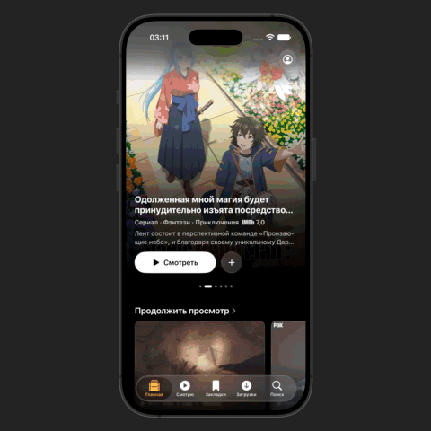

# Telegram Motion Style

Один скилл для промороликов приложений в стиле Telegram Tips: реальная запись,
камера V4, рамка устройства, матовые тапы и свайпы, фокусирование, блики,
эффекты текста **«Normal»** и **«Emotional»**, звук и предпросмотр Remotion.

Всё находится в [skills/telegram-motion-style](skills/telegram-motion-style/SKILL.md).
Одна база знаний, один набор инструментов, одна установка.

## Демонстрация

Проморолик AI-поиска Kino: реальная запись приложения, камера V4 и матовые тапы.

[](https://github.com/idrewha/Telegram-Style-Motion/raw/refs/heads/main/docs/demo/Kino-AI-refined.mp4)

[Полный ролик](https://github.com/idrewha/Telegram-Style-Motion/raw/refs/heads/main/docs/demo/Kino-AI-refined.mp4)
— 29,45 с, 1920×1920, 60 fps, без звука. Доступен для просмотра и скачивания.

## Установка

Репозиторий публичный. Для установки отправьте Codex:

```text
$skill-installer Установи telegram-motion-style из
https://github.com/idrewha/Telegram-Style-Motion/tree/main/skills/telegram-motion-style
```

При ручной установке скопируйте единственную папку `skills/telegram-motion-style`
в пользовательский каталог скиллов вашей среды. Перед обновлением сохраните
локальные правки и `learning/`; не устанавливайте дубликаты.

## Использование

```text
Используй $telegram-motion-style. Сделай проморолик моего приложения
по реальной записи: покажи поиск и результат, сохрани камеру V4 и матовые
жесты, добавь эффект текста Normal и подготовь предпросмотр.
```

Передайте запись или проект, сценарий, подходящую рамку и звук, если нужен.
Запись iOS требует macOS, Xcode и Simulator; монтаж готового видео — Python,
Pillow/NumPy и FFmpeg/ffprobe. Remotion дополнительно требует Node.js и npm.
Обязательных MCP-сервисов нет. Координаты и контакты калибруются по вашему исходнику.

Для камеры, рамки, тапов и объектных акцентов достаточно прямого Python-рендера.
Remotion подключается для Studio и редакционных дорожек. `--render-base`
переиспользует неизменившуюся базу; `--force-base` пересчитывает её принудительно.
Экспорт без текстовых и звуковых дорожек копирует базовый MP4 без браузера
и повторного кодирования.

Из папки скилла:

```sh
python3 -m venv .venv
.venv/bin/python -m pip install -r requirements.txt
.venv/bin/python scripts/motion.py init /path/to/new-work-project
cd /path/to/new-work-project
npm ci
```

[Единый план, Studio и экспорт](skills/telegram-motion-style/references/remotion.md).
Для прямого Python-рендера предусмотрен
[scripts/render.py](skills/telegram-motion-style/references/rendering.md).
Редакционный текст в итоговом кадре и замена текста внутри записи требуют
разной интеграции; подложка и маска записанного UI не создаются автоматически.

## База знаний и движение

[Библиотека приёмов](skills/telegram-motion-style/references/corpus/index.md)
содержит разбор **50 роликов**, **392 события** и **50 сцен** Telegram Tips,
посты 527–576. В ней фокусирование, эмоциональные акценты, скроллинг,
контролы, ввод, AI-ответы, камера, ритм и сценарии. В комплекте CSV/JSON
измерений и выбранные проверочные изображения. Это файловая база знаний;
точные исходные движки и все кривые из референсов не восстановлены.

По умолчанию: 1920×1920, 60 fps; чтение 1,2/1,6 с; записанный финал 2,5 с;
камера с быстрым прибытием и мягким успокоением. Пресет коротких свайпов
описан в [индикаторах жестов](skills/telegram-motion-style/references/gestures.md).
Параметры адаптируются к конкретной записи. Программные значения текстовых
стилей — `normal` и `emotional`; их названия — «Normal» и «Emotional».

## Проверка

Из корня репозитория, с установленными зависимостями и FFmpeg/ffprobe в PATH:

```sh
python3 -m unittest discover -s skills/telegram-motion-style/scripts -p 'test_*.py' -v
node --test skills/telegram-motion-style/scripts/test_text_motion.mjs
node --test skills/telegram-motion-style/assets/remotion/scripts/test-*.mjs
```

Тесты не запускают UI приложения. При изменении структуры отдельно проверяются
создание рабочего проекта и экспорт. Studio не заменяет проверку финального MP4.
Личный журнал создаётся в `learning/` и исключён из Git.

## Лицензии и материалы

Инструкции и авторские дополнения — [MIT](LICENSE).
[Источники и сторонние лицензии](skills/telegram-motion-style/THIRD_PARTY_NOTICES.md).
Remotion устанавливается отдельно и имеет собственные
[условия лицензирования](https://www.remotion.dev/license).

Исходные приложения, частные журналы, записи, полный исследовательский архив,
музыка и рамки Apple не входят в скилл. Используйте разрешённые материалы.
Проект не связан с Telegram или Apple.
